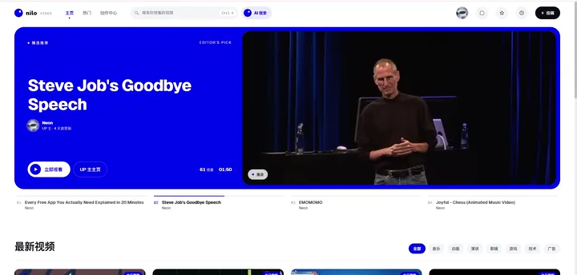
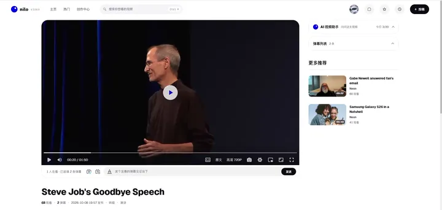

# Agent

Nilo 的站内助手（Agent）基于 Spring AI
实现，回答与站内视频相关的问题：按描述查找视频，查询时长、播放量等数据，以及定位某段内容出现在视频的第几分钟。在视频页提问时，问题默认针对当前视频。并且，助手使用的检索工具同时通过
MCP 服务器对外开放，目前已经在部署的服务器上提供 MCP 服务。

## 使用方式

1. 在主页顶部搜索栏右侧点击“AI 搜索”，在展开的聊天框中输入你想提问的内容：

   

2. 在视频页面中，向侧边栏的 **AI 视频助手** 提问某个片段来源于哪个时间点：

   

3. 上传的视频会自动抽出音频并转换成文本。对于大多数 BGM 并不嘈杂的视频，都可以成功生成字幕。除此之外我们还提供：

    - 字幕自动翻译为中文
    - 自动根据字幕总结视频片段

   

4. 如果你想远程使用本网站的搜索工具，可以让你的 Agent 连接到本网站的 MCP 服务器来搜索本网站的视频（具体使用方式见下文）：

   

   > 想停下来仔细查看动图中的输出？可以观看演示视频：[AI-MCP.mp4](../../img/agent/AI-MCP.mp4)

## 问答流程

1. **意图分类**

   一次独立的模型调用将问题归入七类之一：

    - 找视频
    - 总结视频
    - 自我介绍
    - 站点介绍
    - 投稿帮助
    - 账号帮助
    - 拒绝

   用户输入、上一轮回复与当前视频标题均以标签包裹，作为待分类的数据而非指令；调用失败或无法判定时一律按拒绝处理。

2. **分派**

   站点介绍、投稿帮助、账号帮助与拒绝返回固定答复；总结视频引导用户查看转码阶段预先生成的 AI
   总结，不重复调用模型；自我介绍由一个不挂载任何工具的模型回答（固定回答）。

3. **检索与回答**

   找视频类问题交给挂载了检索工具的模型，调用哪些工具、调用几次由模型决定。系统提示词要求回答中的每条事实都来自本轮工具返回的资料。视频页提问时，字幕检索由服务端限定在当前视频，模型无法更改。

4. **结果核对**

   回答中的时间点必须落在本轮字幕命中片段的时间范围内，对不上的时间点会被删除，全部对不上时回答改为未找到；返回给前端的视频列表只保留回答中提到、且确实由工具检索到的视频，模型编造的
   videoId 不会进入结果。

5. **流式返回**

   通过 SSE 先推送处理进度，核对完成后再分段推送正文，避免未经核对的时间点先显示给用户。

对话记忆按会话存储在 Redis 中，支持多轮追问。每位用户每日的提问次数有上限，提问失败时退还本次额度。

## 工具

| 工具               | 作用                                                                   |
|--------------------|------------------------------------------------------------------------|
| `searchVideo`      | 按语义检索视频，匹配标题、标签与简介，返回最相关的 5 个视频            |
| `getVideoDetail`   | 按 videoId 查询时长、播放量、弹幕数与收藏数                            |
| `searchTranscript` | 按语义检索字幕，返回分 P、起止时间与带时间戳的字幕原文；可限定单个视频 |

工具均为只读。为了保证用 JSON 格式传输时 Long 的精度不会损失， videoId 在参数和返回值中都以字符串表示。

## 检索数据

- **视频索引**：标题、标签和简介开头拼接为一条文本做向量化，较长的简介另行切块。
- **字幕索引**：转码时识别语音生成字幕，出结果后做一次质检，识别结果为乱码时不生成，非中文字幕另译一份中文。索引使用原文语言的字幕，按 30
  秒一块切分、相邻块重叠 10 秒；提供给模型的字幕额外包含前 20 秒，便于找到话题的起点。
- **AI 总结**：转码时由模型生成每个分 P 的总结与章节，章节时间对齐到最近一句台词的开始时间。

视频发布、修改或下架后，canal 捕获数据变更，经消息队列触发对应视频的索引重建。

## MCP 服务器

nilo-ai 也是一个 MCP 服务器，使用 SSE 传输，提供上述三个工具。

- **地址**：`https://www.nilo.video/sse`
- **鉴权**：请求头 `X-Mcp-Token`。MCP token 以网站登录 token（浏览器 Cookie 中的 `token_normal`）调用
  `POST /api/ai/mcp/token` 换取，与网站登录态相互独立；重新生成后旧 token 立即失效，对同一路径发送 `DELETE` 可撤销。
- **额度**：每位用户每日的调用次数有上限，用量与用户绑定，不与 token 绑定。

支持自定义请求头的客户端直接配置地址与请求头，例如 Claude Code：

```bash
claude mcp add --transport sse nilo https://www.nilo.video/sse --header "X-Mcp-Token: <MCP token>"
```

只能配置本地进程的客户端（如 Claude 桌面端）可通过 `mcp-remote` 在本机转接：

```json
{
  "mcpServers": {
    "nilo": {
      "command": "npx",
      "args": [
        "-y",
        "mcp-remote",
        "https://www.nilo.video/sse",
        "--transport",
        "sse-only",
        "--header",
        "X-Mcp-Token:${NILO_MCP_TOKEN}"
      ],
      "env": {
        "NILO_MCP_TOKEN": "<MCP token>"
      }
    }
  }
}
```
