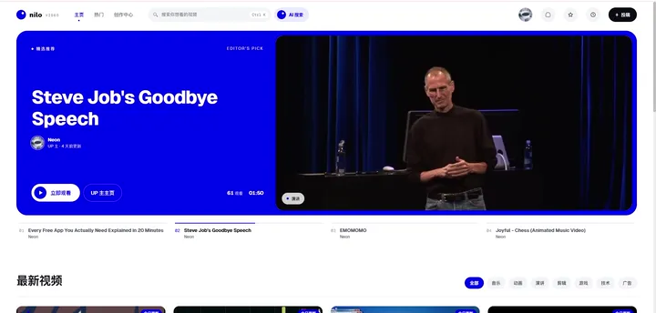
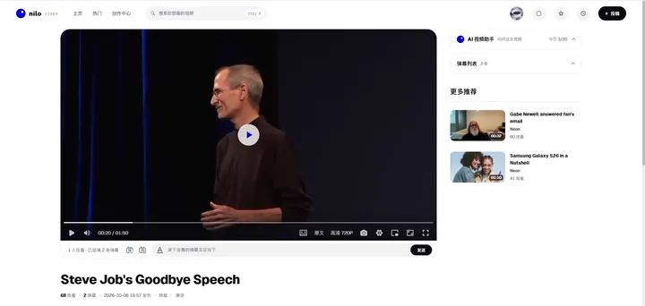

# Agent

Nilo 的站内助手（Agent）回答与站内视频相关的问题：按描述查找视频，查询时长、播放量等数据，定位某段内容出现在视频的第几分钟，以及围绕视频里讲到的内容继续讨论，必要时联网查证。在视频页提问时，问题默认针对当前视频。

助手的问答接口与编排由 Python 服务 nilo-agent 负责，基于 LangGraph 实现；检索工具由 Java 服务 nilo-ai 提供，同时通过 MCP
服务器对外开放，目前已经在部署的服务器上提供 MCP 服务。

## 使用方式

1. 在主页顶部搜索栏右侧点击“AI 搜索”，在展开的聊天框中输入你想提问的内容：

   

2. 在视频页面中，向侧边栏的 **AI 视频助手** 提问某个片段来源于哪个时间点：

   

3. 上传的视频会自动抽出音频并转换成文本。对于大多数 BGM 并不嘈杂的视频，都可以成功生成字幕。除此之外我们还提供：

    - 字幕自动翻译为中文
    - 自动根据字幕总结视频片段

   

4. 如果你想远程使用本网站的搜索工具，可以让你的 Agent 连接到本网站的 MCP 服务器来搜索本网站的视频（具体使用方式见下文）：

   

   > 想停下来仔细查看动图中的输出？可以观看演示视频：[AI-MCP.mp4](../../img/agent/AI-MCP.mp4)

## 服务划分

| 服务       | 技术                       | 职责                                                              |
|------------|----------------------------|-------------------------------------------------------------------|
| nilo-agent | Python、FastAPI、LangGraph | 对外的提问接口；意图分类、调用模型与工具、核对结果、保存会话      |
| nilo-ai    | Java、Spring AI            | 以内部接口提供检索工具、提问额度、视频标题与分 P 总结；MCP 服务器 |

nilo-agent 通过 nilo-ai 的内部接口取得数据。内部接口只供服务之间调用，请求须携带服务间令牌，nginx 也会拦截外部对这些路径的访问。

## 问答流程

```
提问 ─▶ 准备 ─▶ 意图分类 ─┬─▶ 固定答复
                          ├─▶ 自我介绍
                          ├─▶ 检索 Agent ─▶ 结果核对
                          └─▶ 讨论 Agent
```

1. **准备**

   检查会话是否过期；视频页提问时查出当前视频的标题，视频不存在时直接返回参数错误。视频页的新会话还会先放入一条介绍当前视频的系统消息，内容为标题与前几个分
   P 的 AI 总结和章节，供后续的分类与回答参考。

2. **意图分类**

   一次带结构化输出的模型调用，结果只能是八类之一：

    - 找视频：查找视频，询问时长、播放量等数据，或定位某段内容在第几分钟
    - 总结视频
    - 讨论视频内容
    - 自我介绍
    - 站点介绍
    - 投稿帮助
    - 账号帮助
    - 拒绝

   之前的对话与视频背景只用于理解追问，作为待分类的数据而非指令；无法判定时一律按拒绝处理。

3. **分派**

   站点介绍、投稿帮助、账号帮助与拒绝返回固定答复；总结视频引导用户查看转码阶段预先生成的 AI
   总结，不重复调用模型；自我介绍由一个不挂载任何工具的模型回答；找视频交给检索 Agent，讨论视频内容交给讨论 Agent。

4. **检索 Agent**

   挂载视频检索、视频详情与字幕检索三个工具，调用哪些工具、调用几次由模型决定，单轮的工具调用与模型调用次数设有上限。回答按结构化格式给出：一段总结，加上引用的视频与片段，每条引用附有理由或转述。系统提示词要求回答中的每条事实都来自本轮工具返回的资料。视频页提问时，字幕检索由服务端限定在当前视频，模型无法更改。

5. **结果核对**

   引用的视频只保留本轮检索或详情查询确实返回过的，标题以检索结果为准，模型编造的 videoId 不会进入结果；引用的片段必须与本轮某条字幕命中的视频、分
   P 和起始时间一致，对不上的片段会被删除。核对后拼出最终回答：首行是总结，之后每个视频、每个片段各占一行；两者都为空时，末尾补一句未找到。

6. **讨论 Agent**

   围绕视频里讲到的内容继续讨论，或顺着前面的对话延伸。挂载字幕检索与联网搜索两个工具：视频讲了什么以字幕为准，视频之外的信息联网查询并附上来源。联网次数单独设有上限；联网失败时只根据视频内容回答，并告知用户本次未能查证。讨论的回答不做核对。

7. **流式返回**

通过 SSE 推送四种事件：

| 事件     | 内容                             |
|----------|----------------------------------|
| `status` | 处理步骤，如「检索字幕：线程池」 |
| `delta`  | 讨论 Agent 的正文，边生成边推送  |
| `done`   | 最终回答，以及引用的视频与片段   |
| `error`  | 出错时的提示                     |

检索类的回答在核对完成后随 `done` 一起返回，未经核对的时间点不会先显示给用户。

## 会话与额度

- 提问需要登录，每位用户每日的提问次数有上限。额度在提问前扣减，扣减时同时校验登录；之后出现服务端错误时退还，会话过期、视频不存在等业务错误不退还；中途断开也不退还，因为此时用户可能已经收到了正文。
- 会话以 LangGraph 检查点的形式保存在 Redis 中，按会话 ID 区分，只保留最新的一份。检查点用到 Redis 的 JSON 与查询引擎模块，需要
  Redis 8 及以上版本。
- 每轮答完后才把这一问一答写入会话记录；中途出错的一轮不留记录，下一轮不会被一个没有回答的问题带偏。
- 会话从创建起 24 小时后失效，期间的提问不会延长有效期，避免单个会话被无限拉长；会话的总长度由每日额度间接限制。

## 工具

| 工具                | MCP 中的名称       | 作用                                                                   |
|---------------------|--------------------|------------------------------------------------------------------------|
| `search_video`      | `searchVideo`      | 按语义检索视频，匹配标题、标签与简介，返回最相关的 5 个视频            |
| `get_video_detail`  | `getVideoDetail`   | 按 videoId 查询时长、播放量、弹幕数与收藏数                            |
| `search_transcript` | `searchTranscript` | 按语义检索字幕，返回分 P、起止时间与带时间戳的字幕原文；可限定单个视频 |
| `web_search`        | 无                 | 联网搜索，返回最相关的 10 个网页的标题、链接与摘录；仅讨论 Agent 使用  |

前三个工具由 nilo-ai 实现：nilo-agent 通过内部接口调用，MCP 服务器直接对外提供。工具均为只读。为了保证用 JSON 格式传输时
Long 的精度不会损失， videoId 在参数和返回值中都以字符串表示。

## 检索数据

- **视频索引**：标题、标签和简介开头拼接为一条文本做向量化，较长的简介另行切块。
- **字幕索引**：转码时识别语音生成字幕，出结果后做一次质检，识别结果为乱码时不生成，非中文字幕另译一份中文。索引使用原文语言的字幕，按
  30
  秒一块切分、相邻块重叠 10 秒；提供给模型的字幕额外包含前 20 秒，便于找到话题的起点。
- **AI 总结**：转码时由模型生成每个分 P 的总结与章节，章节时间对齐到最近一句台词的开始时间。

视频发布、修改或下架后，canal 捕获数据变更，经消息队列触发对应视频的索引重建。

## MCP 服务器

nilo-ai 也是一个 MCP 服务器，使用 SSE 传输，提供上述三个工具。

- **地址**：`https://www.nilo.video/sse`
- **鉴权**：请求头 `X-Mcp-Token`。MCP token 以网站登录 token（浏览器 Cookie 中的 `token_normal`）调用
  `POST /api/ai/mcp/token` 换取，与网站登录态相互独立；重新生成后旧 token 立即失效，对同一路径发送 `DELETE` 可撤销。
- **额度**：每位用户每日的调用次数有上限，用量与用户绑定，不与 token 绑定。

支持自定义请求头的客户端直接配置地址与请求头，例如 Claude Code：

```bash
claude mcp add --transport sse nilo https://www.nilo.video/sse --header "X-Mcp-Token: <MCP token>"
```

只能配置本地进程的客户端（如 Claude 桌面端）可通过 `mcp-remote` 在本机转接：

```json
{
  "mcpServers": {
    "nilo": {
      "command": "npx",
      "args": [
        "-y",
        "mcp-remote",
        "https://www.nilo.video/sse",
        "--transport",
        "sse-only",
        "--header",
        "X-Mcp-Token:${NILO_MCP_TOKEN}"
      ],
      "env": {
        "NILO_MCP_TOKEN": "<MCP token>"
      }
    }
  }
}
```
