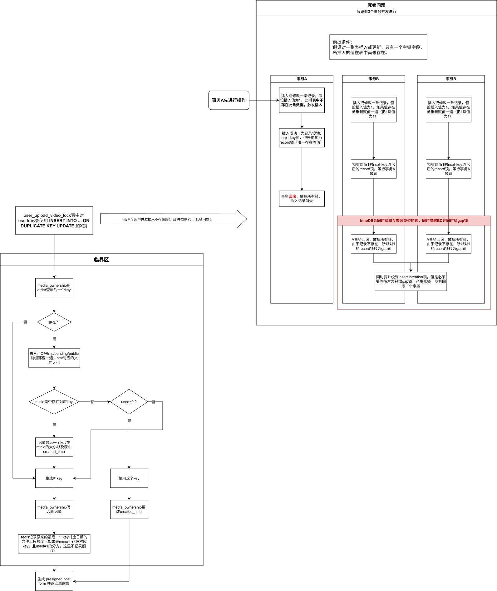

# 上传文件日额度限制

## 简介

本文介绍了本项目如何在前端直传的情况下限制每日上传额度，以及该设计在单用户并发上传时可能触发的 InnoDB 死锁问题。

> 图片为 svg 格式，建议下载后在浏览器中查看。

    
    
整体链路图示

## 日配额

### 背景

视频文件体积较大，需要由前端直接上传到 MinIO，因此服务端无法在上传时校验配额。

### 方案

文件上传前需要给前端一个"上传许可"，即 MinIO presigned POST。这个许可可以限制上传的文件大小，因此采用 **Redis 记录日限额 +
presigned POST 限制上传大小** 的方式严格控制上传限额。

### 并发问题

并发上传时，前端可能同时拿到两个 key，而两个 key 都带有相同的额度限制，合计可能超出配额。因此设计上保证 **每次只签发一个未使用的
key**：已经签发但未使用的 key，会在下一次请求中再次提供给前端。

### 处理逻辑

前端上传不经过服务端，而每次签发新 key 前都需要检查是否有未使用的
key。因此每次调用 [申请 key 的接口](../../../nilo-web/src/main/java/com/neon/niloweb/controller/FileController.java#L97)
时，都会检查最后一个签发的 key：

- 如果该 key 还没有使用，则直接复用；
- 否则检查它在 MinIO 中的实际大小，并记录到当天的上传配额。

### 调用链路

【见上图左侧部分】

| 步骤 | 说明                       | 代码位置                                                                                                                  |
|:----:|----------------------------|---------------------------------------------------------------------------------------------------------------------------|
|  1   | 对外暴露接口               | [`FileController#uploadVideo`](../../../nilo-web/src/main/java/com/neon/niloweb/controller/FileController.java#L97)       |
|  2   | 具体处理逻辑               | [`FileService#uploadVideo`](../../../nilo-web/src/main/java/com/neon/niloweb/service/FileService.java#L196)               |
|  3   | 进入临界区                 | [`UploadService#getUploadKey`](../../../nilo-web/src/main/java/com/neon/niloweb/service/UploadService.java#L61)           |
|  4   | 返回后继续执行剩余处理逻辑 | [`FileService#uploadVideo`（临界区之后）](../../../nilo-web/src/main/java/com/neon/niloweb/service/FileService.java#L205) |

## InnoDB 死锁问题

### 现象

单用户并发上传时会触发 InnoDB 死锁（并发数 ≥ 3 时触发）。

### 原因分析

多个事务同时执行 `INSERT ... ON DUPLICATE KEY UPDATE`，且目标行不存在时：

1. 先插入的事务回滚；
2. 回滚会同时唤醒其它等待的事务，并将它们的 record 锁转为（唯一索引上的）gap 锁；
3. 这些事务彼此持有相互兼容的 gap 锁，随后又都要升级为 insert intention 锁，互相等待，形成死锁。

### 相关代码

【见上图右侧部分】

[
`UserUploadVideoLockMapper#tryLock`](../../../nilo-web/src/main/java/com/neon/niloweb/mapper/UserUploadVideoLockMapper.java#L19) → [
`UserUploadVideoLockMapper.xml`](../../../nilo-web/src/main/resources/mapper/UserUploadVideoLockMapper.xml#L131)
