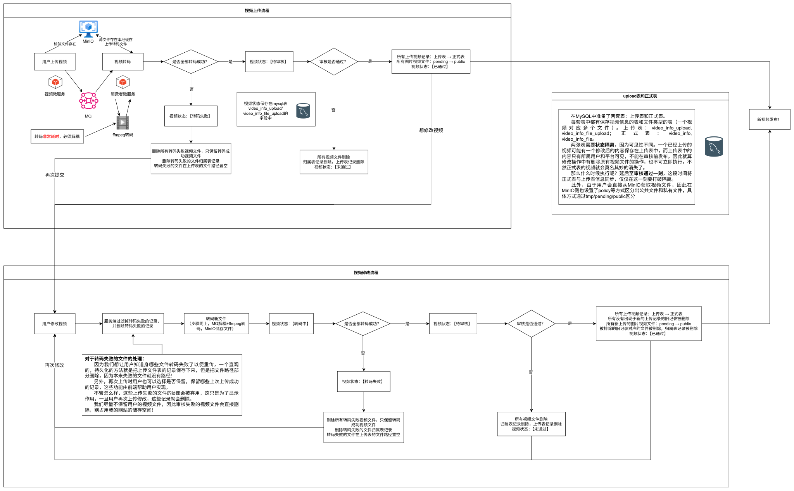

# 视频上传链路

## 简介

本文说明视频上传、转码、审核与发布的链路。

> 图片为 svg 格式，建议下载后在浏览器中查看。

    
    
整体链路图示

## 设计要点

视频上传 / 审核 / 发布状态机：

- **状态持久化**：上传、转码、审核状态通过 MySQL 字段持久化，阶段完成后写入状态并可供用户查看。
- **状态隔离**：MySQL 上传表与正式表状态隔离，保证修改后的视频在未审核通过期间，正式表内容保持公开且不变，仅在审核通过的同步点统一迁移更改到正式表。
- **权限分区**：文件在 MinIO 保存，按 `tmp` / `pending` / `public` 三段前缀分区，并配置 MinIO policy
  区分公私读取权限，保证审核通过的视频才可公开读取。
- **转码解耦**：转码经 MQ 解耦至独立消费微服务（FFmpeg），部分失败时保留成功文件、置空失败路径，以支持用户增量重传。

## 调用链路

| 步骤 | 说明                                                             | 代码位置                                                                                                                                                |
|:----:|------------------------------------------------------------------|---------------------------------------------------------------------------------------------------------------------------------------------------------|
|  1   | 上传文件接口（具体处理见 [上传文件日额度限制](upload-quota.md)） | [`FileController#uploadVideo`](../../../nilo-web/src/main/java/com/neon/niloweb/controller/FileController.java#L97)                                     |
|  2   | 上传 / 修改视频接口                                              | [`CreativeCenterController#videoUpload`](../../../nilo-web/src/main/java/com/neon/niloweb/controller/CreativeCenterController.java#L67)                 |
|  3   | 具体处理逻辑                                                     | [`CreativeCenterService#videoUpload`](../../../nilo-web/src/main/java/com/neon/niloweb/service/CreativeCenterService.java#L96)                          |
|  4   | 转码视频文件                                                     | [`VideoTransCodingConsumer#receiveMessage`](../../../nilo-mq-consumer/src/main/java/com/neon/nilomqconsumer/consumer/VideoTransCodingConsumer.java#L81) |
|  5   | 审核视频接口                                                     | [`VideoController#reviewVideo`](../../../nilo-admin/src/main/java/com/neon/niloadmin/controller/VideoController.java#L81)                               |
|  6   | 具体审核逻辑                                                     | [`VideoService#reviewVideo`](../../../nilo-admin/src/main/java/com/neon/niloadmin/service/VideoService.java#L158)                                       |
|  7   | 发送异步消息通知用户                                             | [`UserMessageService#sendVideoReviewMessage`](../../../nilo-admin/src/main/java/com/neon/niloadmin/service/UserMessageService.java#L40)                 |
